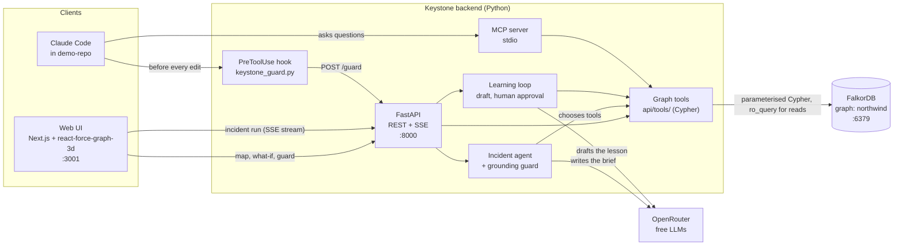
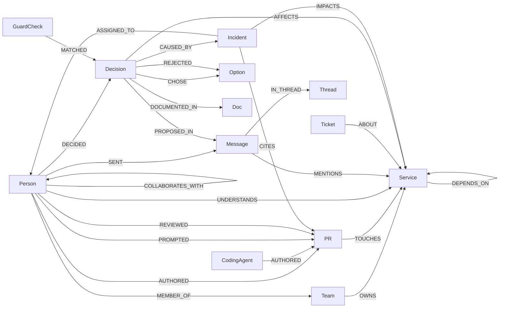

# Keystone: know who knows

**A company brain on FalkorDB that knows who actually understands your systems, runs incidents with evidence, learns from them, and stops AI coding agents from repeating mistakes the company already paid for.**


| Track | How Keystone fits |
|---|---|
| **Track 03: Company Brain** | PRs, reviews, tickets, chat, architecture decisions and people in one graph; *who owns* vs *who understands*; decisions traced to their source; knowledge kept current; every answer cites its sources |
| **Track 01: Agents That Act on Connected Data** | An incident agent that reasons over the graph hop by hop, uses graph algorithms as tools, is served over MCP, and **acts**: it opens and assigns incidents, writes learned rules, and blocks risky edits by coding agents |


---

## The problem

AI coding agents now write a large share of the code, and humans approve it, often in seconds. The org chart says who **owns** a system. Nobody tracks who still **understands** it. You find out at 2 AM, when production is down, the on-call engineer has left the company, and nobody remembers why the system was built this way or that someone warned about exactly this.

## What Keystone does

| Feature | What it does | Built on |
|---|---|---|
| **Comprehension map** | Scores how well each *person* understands each *service* from evidence (authored PRs, careful reviews, rubber stamps, incidents) and colours services **healthy / fragile / dark** | derived `UNDERSTANDS` edges, PageRank |
| **Incident commander** | Takes a service down, then walks the graph step by step: suspect change → blast radius → official owner → who really knows → why it's built this way → who warned us. Writes a brief where **every sentence cites graph nodes**, opens the incident and assigns the real expert | multi-hop Cypher, full-text search, LLM tool calling |
| **Learning loop** | A resolved incident becomes a drafted lesson; **nothing is written until a human approves**; the approved rule (`LRN-0xx`) is linked to the incident that taught it | `Decision`, `Option`, `CAUSED_BY` |
| **Decision guard** | Before Claude Code edits a file, a pre-edit hook asks Keystone; changes the team already rejected are **denied**, with the reason and who to ask. The same tools are available over **MCP** | full-text match on rejected options |
| **What-if simulator** | Who is most dangerous to lose, what goes dark if someone leaves and who should learn it, and what breaks when services go down | betweenness, PageRank, read-only queries |

The demo company, **Northwind Labs**, is a fictional payments business: 59 people, 3 AI coding agents, 9 teams, 22 services, 425 PRs, 150 tickets, 591 chat messages and 24 architecture decisions, about **1,400 nodes and 4,500 relationships**.

---

## Why FalkorDB is load-bearing

FalkorDB is the **only** datastore. Every feature is a Cypher traversal or a graph algorithm; take the graph away and nothing works.

| Job | What it needs from the graph |
|---|---|
| Who understands a service | evidence paths Person → PR → Service (authored / reviewed / prompted), materialised as `UNDERSTANDS` |
| Blast radius | variable-length `DEPENDS_ON*1..4` traversal with the shortest path per service |
| What the company depends on | `algo.pageRank` over `DEPENDS_ON` |
| Who connects the company | `algo.betweenness` over `COLLABORATES_WITH` |
| Why it's built this way | Decision → Option (chosen / rejected) → Doc → chat Message → People |
| Did anyone warn us | full-text search over messages and open tickets, filtered by the service they mention |
| Decision guard | full-text match against **rejected** options of decisions affecting the service, plus the incident behind them |
| Evidence on the map | only real edges between the nodes a step returned (`edges_between`): no line is ever guessed |

**Safety:** the LLM **never writes Cypher**. It can only choose among hand-written, parameterised tools that run with `ro_query` (read-only). Writes (incidents, citations, rules) are executed by the server, and only when grounded: the assignee must be the top person in `who_knows`, and a lesson must be approved by a human.

---

## Architecture



- **One code path, three front doors.** The web UI goes through FastAPI, Claude Code's hook calls the same `/guard` endpoint, and the MCP server imports the same tool functions directly. All of them end in the same Cypher on the same graph.
- **Incidents stream live.** Each agent step is sent to the browser over Server-Sent Events as it happens, so the 3D camera can fly to what the step found while the LLM is still writing.
- **FalkorDB is the only datastore.** There's no SQL, cache or file state: the API rebuilds the demo graph from `data/northwind` on first boot.

---

## Graph model



| Node | Key | Notes |
|---|---|---|
| `Person` | `handle` | `status`: active / departed |
| `Team`, `Service`, `CodingAgent`, `Datastore` | `slug` / `name` | Service has `tier` (1 = critical) |
| `PR` | `id` | `lines`, `merged_at`; reviews carry `secs` and `comments` |
| `Ticket`, `Doc`, `Message`, `Thread` | `key` / `id` | full-text indexed (messages, tickets, docs) |
| `Decision`, `Option` | `id` | ADRs and learned rules (`LRN-0xx`); options are full-text indexed |
| `Incident`, `GuardCheck`, `Risk` | `id` | written by the agent and the guard |
| `Dataset` | | the demo clock (`as_of`), so story dates stay true |

**Derived edges** (`scripts/derive.py`):
- `UNDERSTANDS {score}` = Σ evidence weight × recency.
- Evidence weights: authored PR ×3, deep review (≥ 5 min or ≥ 2 comments) ×2, light review ×0.5, rubber stamp (< 2 min, 0 comments) ×0.2, prompted an agent PR with comments ×1.5, resolved incident ×4, chat mention ×0.5.
- Recency multiplier: 1.0 if under 90 days old, 0.5 if under a year, 0.15 if older.
- An expert is anyone with a score ≥ 5. A service with 0 experts is **dark**, with 1 is **fragile**, with 2 or more is **healthy**.

---

## Cypher queries and graph algorithms

Everything Keystone does is one of the queries below, copied from the code. Each tool lives in `api/tools/` (one file per tool, with its Cypher and a comment on why it needs a graph) and returns `{rows, keys, cypher, params, ms}`. All values are `$parameters` and every read runs with `ro_query`. In the UI, the **Cypher** drawer shows each query as it runs, with its timing (most take 1–5 ms).

### Graph algorithms and indexes

| What | Cypher | Used for |
|---|---|---|
| **PageRank** | `CALL algo.pageRank('Service', 'DEPENDS_ON')` | service size on the map; ranking what breaks by how much depends on it |
| **Betweenness centrality** | `CALL algo.betweenness({nodeLabels: ['Person'], relationshipTypes: ['COLLABORATES_WITH'], samplingSize: 64, samplingSeed: 42})` | who connects the company ("bridge #1") |
| **Full-text search** | `CALL db.idx.fulltext.queryNodes('Option' \| 'Message' \| 'Ticket', $terms)` | decision guard; "did anyone warn us?" |
| **Variable-length paths** | `(:Service)<-[:DEPENDS_ON*1..4]-(:Service)` | blast radius with the shortest path |
| **Indexes** | a range index on every node key, plus `CREATE FULLTEXT INDEX` on `Doc(title, body)`, `Message(text)`, `Option(text, keywords)`, `Ticket(title)` | anchoring every query on an indexed node (checked with `GRAPH.EXPLAIN`) |

### Every query, by feature

| Feature | Query (file) | What it answers |
|---|---|---|
| Comprehension score | `Q3A–Q3E`, `Q3W` (`api/seed.py`) | evidence per person and service (authored, reviews classified deep / light / stamp, incidents, prompted agent PRs, chat), written as `UNDERSTANDS` |
| | `DERIVE_COLLAB` (`api/seed.py`) | who works with whom (`COLLABORATES_WITH`, shared PRs) |
| Comprehension map | `comprehension_map` | per service: agent-written share (90 d), active experts → dark / fragile / healthy |
| | `stamp_chains` (+ `SUMMARY`) | agent PRs a human approved in < 2 min with 0 comments |
| | `knowledge_spread` | best mentor and the person who touched it most without understanding it |
| Incident commander | `suspect_changes` | the newest PRs: agent or human author, who prompted it, how it was reviewed |
| | `blast_radius` | everything upstream within 4 hops, with owner team and shortest path |
| | `current_owners` | the org chart: owning team, members, this week's on-call (and if they left) |
| | `who_knows` | active people ranked by understanding, with their PRs as evidence |
| | `decision_trace` | decisions affecting the service: ADR, the chat message it came from, deciders, rejected options |
| | `prior_warnings` (`MESSAGES`, `TICKETS`) | full-text search for warnings in chat and still-open tickets about the service |
| Actions (writes) | `open_incident` (`CREATE`, `DOWNSTREAM`) | the incident, `IMPACTS` and `ASSIGNED_TO` |
| | `cite` | `CITES` edges from the incident to every node a claim relies on |
| | `resolve_incident`, `set_service_status`, `file_risk` | resolve and credit the resolver, mark a service down/up, file a risk |
| Learning loop | `INCIDENT`, `WRITE_*` (`api/learn.py`) | read the incident; on approval, write the rule, its options, `CAUSED_BY`, `AFFECTS`, `DECIDED` |
| Decision guard | `check_decision`, `log_guard` | full-text match against rejected options; audit every call as a `GuardCheck` |
| What-if | `what_if` (`LEAVE`, `ZONES`, `LEARNERS`) | zones without the people who leave, the company-wide diff, and who should learn |
| | `services_down` (`PAGERANK`, `CALL`) | merged blast radius ranked by PageRank, and who to call |
| | `danger_ranking` (`SPOF`, `BRIDGES`) | single points of failure, plus betweenness |
| 3D map | `api/map.py`, `edges_between` | the map's nodes and links; the real edges behind evidence lines |

<details>
<summary><b>Comprehension score</b>: how <code>UNDERSTANDS</code> is derived (<code>api/seed.py</code>)</summary>

```cypher
// Q3a: a human authored a PR touching the service
MATCH (p:Person)-[a:AUTHORED]->(pr:PR)-[:TOUCHES]->(s:Service)
RETURN p.handle AS who, s.name AS svc, 'authored' AS kind, a.at AS at

// Q3b: reviews, classified deep / stamp / light from how long and how much the reviewer engaged
MATCH (p:Person)-[r:REVIEWED]->(pr:PR)-[:TOUCHES]->(s:Service)
RETURN p.handle AS who, s.name AS svc,
       CASE WHEN r.secs >= 300 OR r.comments >= 2 THEN 'deep'
            WHEN r.secs < 120 AND r.comments = 0 THEN 'stamp'
            ELSE 'light' END AS kind,
       r.at AS at

// Q3c: resolved incidents rooted in the service, credited to the person who handled them
MATCH (p:Person)<-[:ASSIGNED_TO]-(i:Incident {status: 'resolved'})-[:IMPACTS {role: 'root'}]->(s:Service)
RETURN p.handle AS who, s.name AS svc, 'incident' AS kind, i.opened_at AS at

// Q3d: a human prompted a coding agent's PR; it only counts as understanding if they commented on it
MATCH (p:Person)-[pp:PROMPTED]->(pr:PR)-[:TOUCHES]->(s:Service)
RETURN p.handle AS who, s.name AS svc,
       CASE WHEN pp.comments > 0 THEN 'prompted' ELSE 'prompted_silent' END AS kind,
       pp.at AS at

// Q3e: chat messages that mention the service
MATCH (p:Person)-[:SENT]->(m:Message)-[:MENTIONS]->(s:Service)
RETURN p.handle AS who, s.name AS svc, 'chat' AS kind, m.sent_at AS at

// Q3w: write the weighted, recency-adjusted scores as UNDERSTANDS edges (one hop at question time)
UNWIND $rows AS r
MATCH (p:Person {handle: r.who}), (s:Service {name: r.svc})
MERGE (p)-[u:UNDERSTANDS]->(s)
SET u.score = r.score, u.authored = r.authored, u.deep_reviews = r.deep_reviews, u.light_reviews = r.light_reviews,
    u.stamps = r.stamps, u.prompted = r.prompted, u.last_seen = r.last_seen, u.computed_at = $now

// Collaboration: pairs of people who worked on the same PR, in both directions
MATCH (a:Person)-[:AUTHORED|REVIEWED]->(pr:PR)<-[:AUTHORED|REVIEWED]-(b:Person)
WHERE id(a) < id(b)
WITH a, b, count(DISTINCT pr) AS shared
MERGE (a)-[r1:COLLABORATES_WITH]->(b) SET r1.shared = shared, r1.weight = 1.0 / shared
MERGE (b)-[r2:COLLABORATES_WITH]->(a) SET r2.shared = shared, r2.weight = 1.0 / shared
```
</details>

<details>
<summary><b>Comprehension map</b>: zones, stamp chains, knowledge spread</summary>

```cypher
// comprehension_map: agent-written share of the last 90 days and active experts -> dark / fragile / healthy
MATCH (s:Service)
OPTIONAL MATCH (s)<-[:TOUCHES]-(pr:PR) WHERE pr.merged_at > $now - 7776000000
OPTIONAL MATCH (pr)<-[:AUTHORED]-(ag:CodingAgent)
WITH s, sum(pr.lines) AS lines,
     sum(CASE WHEN ag IS NULL THEN 0 ELSE pr.lines END) AS agent_lines
OPTIONAL MATCH (p:Person {status: 'active'})-[u:UNDERSTANDS]->(s) WHERE u.score >= $threshold
WITH s, lines, agent_lines, collect(p.handle) AS experts
RETURN s.name AS service, s.tier AS tier,
       CASE WHEN lines = 0 THEN 0.0 ELSE toFloat(agent_lines) / lines END AS agent_share,
       size(experts) AS human_experts, experts,
       CASE WHEN size(experts) = 0 THEN 'dark'
            WHEN size(experts) = 1 THEN 'fragile'
            ELSE 'healthy' END AS zone
ORDER BY tier ASC, human_experts ASC, agent_share DESC

// stamp_chains: agent-authored PRs a human approved in under 2 minutes with no comments
MATCH (s:Service {name: $service})
WITH s
MATCH (ag:CodingAgent)-[:AUTHORED]->(pr:PR)-[:TOUCHES]->(s)
MATCH (pr)<-[r:REVIEWED]-(p:Person)
WHERE r.secs < 120 AND r.comments = 0
OPTIONAL MATCH (pp:Person)-[:PROMPTED]->(pr)
RETURN pr.id AS pr, pr.title AS title, pr.lines AS lines, ag.name AS agent,
       pp.handle AS prompted_by, p.handle AS approver, r.secs AS secs
ORDER BY lines DESC LIMIT 10

// stamp_chains SUMMARY: totals for the headline ("16 approvals under 90 s")
MATCH (s:Service {name: $service})
WITH s
MATCH (ag:CodingAgent)-[:AUTHORED]->(pr:PR)-[:TOUCHES]->(s)
MATCH (pr)<-[r:REVIEWED]-(p:Person)
WHERE r.secs < 120 AND r.comments = 0
RETURN count(DISTINCT pr) AS stamped_prs, sum(CASE WHEN r.secs < 90 THEN 1 ELSE 0 END) AS under_90s,
       avg(r.secs) AS avg_secs

// knowledge_spread: best mentor, and who touched it most without understanding it
MATCH (s:Service {name: $service})
WITH s
MATCH (e:Person {status: 'active'})-[ue:UNDERSTANDS]->(s)
MATCH (l:Person {status: 'active'})-[ul:UNDERSTANDS]->(s)
WHERE l <> e
RETURN e.handle AS mentor, ue.score AS mentor_score,
       l.handle AS learner, ul.score AS learner_score, ul.stamps + ul.prompted AS shallow_touches
ORDER BY mentor_score DESC, shallow_touches DESC LIMIT 1
```
</details>

<details>
<summary><b>Incident commander</b>: the six investigation tools</summary>

```cypher
// suspect_changes: newest PRs, agent or human author, who prompted the agent, how it was reviewed
MATCH (s:Service {name: $service})
WITH s
MATCH (pr:PR)-[:TOUCHES]->(s)
WHERE pr.merged_at >= $since
OPTIONAL MATCH (ag:CodingAgent)-[:AUTHORED]->(pr)
OPTIONAL MATCH (h:Person)-[:AUTHORED]->(pr)
OPTIONAL MATCH (pp:Person)-[:PROMPTED]->(pr)
OPTIONAL MATCH (rv:Person)-[r:REVIEWED]->(pr)
RETURN pr.id AS pr, pr.title AS title, pr.body AS body, pr.merged_at AS merged_at, pr.lines AS lines,
       ag.name AS agent_author, h.handle AS human_author, pp.handle AS prompted_by,
       collect({by: rv.handle, secs: r.secs, comments: r.comments}) AS reviews
ORDER BY merged_at DESC LIMIT 5

// blast_radius: everything upstream within 4 DEPENDS_ON hops, its shortest hop count, one shortest path, its owner
MATCH p = (down:Service {name: $service})<-[:DEPENDS_ON*1..4]-(up:Service)
WITH up, p ORDER BY length(p)
WITH up, min(length(p)) AS hops, collect(p)[0] AS sample
OPTIONAL MATCH (up)<-[o:OWNS]-(t:Team) WHERE o.valid_to IS NULL
RETURN up.name AS service, up.tier AS tier, hops, t.slug AS owner_team,
       [n IN nodes(sample) | n.name] AS path
ORDER BY tier ASC, hops ASC

// current_owners: the owning team, its current members, and who is on call this week
MATCH (s:Service {name: $service})<-[o:OWNS]-(t:Team)
WHERE o.valid_to IS NULL
OPTIONAL MATCH (t)<-[m:MEMBER_OF]-(p:Person)
WHERE m.valid_to IS NULL
OPTIONAL MATCH (oc:Person)-[:ON_CALL_FOR {week: $week}]->(s)
RETURN t.slug AS team,
       collect(DISTINCT {handle: p.handle, status: p.status}) AS members,
       oc.handle AS on_call, oc.status AS on_call_status

// who_knows: active people ranked by understanding, with their PRs as evidence (anchored on the Service index)
MATCH (s:Service {name: $service})
WITH s
MATCH (s)<-[k:UNDERSTANDS]-(p:Person) WHERE p.status = 'active'
OPTIONAL MATCH (p)-[:AUTHORED|REVIEWED]->(pr:PR)-[:TOUCHES]->(s)
WITH p, k, s, pr ORDER BY pr.merged_at DESC
RETURN p.handle AS person, p.role AS role, k.score AS score,
       k.authored AS authored, k.deep_reviews AS deep_reviews, k.light_reviews AS light_reviews,
       k.stamps AS stamps, k.last_seen AS last_seen,
       collect(pr.id) AS recent_prs
ORDER BY score DESC
LIMIT $k

// decision_trace: every decision affecting the service, its ADR, the chat message it came from,
// who decided, what was rejected and why, and whether a newer decision replaced it
MATCH (s:Service {name: $service})<-[:AFFECTS]-(d:Decision)
OPTIONAL MATCH (d)-[:DOCUMENTED_IN]->(doc:Doc)
OPTIONAL MATCH (d)-[:PROPOSED_IN]->(m:Message)<-[:SENT]-(author:Person)
OPTIONAL MATCH (m)-[:IN_THREAD]->(th:Thread)
OPTIONAL MATCH (d)<-[:DECIDED]-(dec:Person)
OPTIONAL MATCH (d)-[rj:REJECTED]->(o:Option)
OPTIONAL MATCH (newer:Decision)-[:SUPERSEDES]->(d)
RETURN d.id AS decision, d.summary AS summary, d.status AS status, d.decided_at AS decided_at,
       collect(DISTINCT doc.id) AS docs,
       collect(DISTINCT {id: m.id, text: m.text, by: author.handle, channel: th.channel, at: m.sent_at}) AS origin,
       collect(DISTINCT dec.handle) AS deciders,
       collect(DISTINCT {text: o.text, reason: rj.reason}) AS rejected,
       newer.id AS superseded_by
ORDER BY decided_at DESC

// prior_warnings MESSAGES: chat messages matching the terms AND mentioning the service
CALL db.idx.fulltext.queryNodes('Message', $terms) YIELD node, score
MATCH (node)-[:MENTIONS]->(s:Service {name: $service})
MATCH (author:Person)-[:SENT]->(node)-[:IN_THREAD]->(th:Thread)
RETURN node.id AS id, node.text AS text, author.handle AS by, th.channel AS channel,
       node.sent_at AS at, score
ORDER BY score DESC
LIMIT 5

// prior_warnings TICKETS: tickets about the service that match the terms and are not done
CALL db.idx.fulltext.queryNodes('Ticket', $terms) YIELD node, score
MATCH (node)-[:ABOUT]->(s:Service {name: $service})
WHERE node.status <> 'done'
OPTIONAL MATCH (who:Person)-[:ASSIGNED]->(node)
RETURN node.key AS id, node.title AS text, who.handle AS by, node.status AS status,
       node.created_at AS at, score
ORDER BY score DESC
LIMIT 5
```
</details>

<details>
<summary><b>Actions</b>: what the agent writes to the graph</summary>

```cypher
// open_incident: create the incident at the demo clock's "now", impacting the service, assigned to a person
MATCH (s:Service {name: $service}), (p:Person {handle: $assignee})
CREATE (i:Incident {id: $id, title: $title, severity: $severity, opened_at: $now, status: 'open', brief: $brief})
CREATE (i)-[:IMPACTS {role: 'root'}]->(s)
CREATE (i)-[:ASSIGNED_TO {reason: $reason}]->(p)
RETURN i.id AS id, i.opened_at AS opened_at

// open_incident DOWNSTREAM: impacted upstream services (a separate statement so an empty list still works)
MATCH (i:Incident {id: $id})
UNWIND $downstream AS name
MATCH (x:Service {name: name})
CREATE (i)-[:IMPACTS {role: 'downstream'}]->(x)

// cite: link the incident to every node a claim relies on (one statement per label;
// labels can't be $parameters, so <Label>/<key> come from a fixed whitelist, values are $parameters)
MATCH (i:Incident {id: $id}) UNWIND $rows AS c
MATCH (n:<Label> {<key>: c.key})
CREATE (i)-[:CITES {claim: c.claim, path_keys: c.path_keys}]->(n)

// resolve_incident: resolve it, credit the resolver, bring the service back up
MATCH (i:Incident {id: $id}), (p:Person {handle: $resolver})
SET i.status = 'resolved', i.resolved_at = $now, i.root_cause = $root_cause
MERGE (i)-[:RESOLVED_BY]->(p)
WITH i
MATCH (i)-[:IMPACTS {role: 'root'}]->(s:Service)
SET s.status = 'up'
RETURN i.id AS id, s.name AS service, i.status AS status

// set_service_status: take a service down (or up)
MATCH (s:Service {name: $service})
SET s.status = $status
RETURN s.name AS service, s.status AS status

// file_risk: create or update a risk on a service (MERGE: re-running the scan doesn't duplicate it)
MATCH (s:Service {name: $service})
MERGE (r:Risk {id: $id})
SET r.kind = $kind, r.score = $score, r.created_at = $now
MERGE (r)-[:ON]->(s)
RETURN r.id AS id, r.kind AS kind, r.score AS score
```
</details>

<details>
<summary><b>Learning loop</b>: from a resolved incident to an approved rule (<code>api/learn.py</code>)</summary>

```cypher
// INCIDENT: the incident to learn from, its root service and resolver
MATCH (i:Incident {id: $id})-[:IMPACTS {role: 'root'}]->(s:Service)
OPTIONAL MATCH (i)-[:RESOLVED_BY]->(p:Person)
RETURN i.id AS id, i.title AS title, i.brief AS brief, i.root_cause AS root_cause, i.status AS status,
       i.opened_at AS opened_at, s.name AS service, p.handle AS resolver

// Only after a human approves:
// WRITE_DECISION: the lesson becomes an active Decision, marked as learned
MERGE (d:Decision {id: $decision_id})
SET d.title = $title, d.summary = $summary, d.status = 'active', d.decided_at = $now, d.origin = 'learned'

// WRITE_CAUSED_BY: it exists because of this incident (the guard cites it)
MATCH (d:Decision {id: $decision_id}), (i:Incident {id: $incident_id})
MERGE (d)-[:CAUSED_BY]->(i)

// WRITE_OPTIONS: what to do, and what never to do again (the rejected option is what the guard matches)
MATCH (d:Decision {id: $decision_id})
MERGE (c:Option {id: $decision_id + '-chosen'}) SET c.text = $chosen, c.keywords = $chosen_keywords
MERGE (r:Option {id: $decision_id + '-rejected'}) SET r.text = $rejected, r.keywords = $keywords
MERGE (d)-[:CHOSE]->(c)
MERGE (d)-[rj:REJECTED]->(r) SET rj.reason = $reason

// WRITE_AFFECTS: which services the rule protects
MATCH (d:Decision {id: $decision_id})
UNWIND $affects AS svc
MATCH (s:Service {name: svc})
MERGE (d)-[:AFFECTS]->(s)

// WRITE_DECIDED: the human who approved it becomes a decider ("ask @marco")
MATCH (d:Decision {id: $decision_id}), (p:Person {handle: $approver})
MERGE (p)-[:DECIDED]->(d)
```
</details>

<details>
<summary><b>Decision guard</b>: check every proposed change, audit every call</summary>

```cypher
// check_decision: full-text match of the proposal against REJECTED options of decisions affecting the service,
// with the reason, the incident behind the decision, the ADR, and who to ask (active deciders only)
CALL db.idx.fulltext.queryNodes('Option', $terms) YIELD node AS o, score
MATCH (d:Decision)-[rj:REJECTED]->(o)
MATCH (d)-[:AFFECTS]->(s:Service {name: $service})
OPTIONAL MATCH (d)-[:CHOSE]->(c:Option)
OPTIONAL MATCH (d)-[:DOCUMENTED_IN]->(doc:Doc)
OPTIONAL MATCH (d)-[:CAUSED_BY]->(inc:Incident)
OPTIONAL MATCH (d)<-[:DECIDED]-(who:Person)
OPTIONAL MATCH (newer:Decision)-[:SUPERSEDES]->(d)
RETURN d.id AS decision, d.summary AS summary, d.status AS status,
       o.id AS option, o.text AS rejected_option, o.keywords AS keywords, rj.reason AS reason,
       c.text AS chosen_option, c.keywords AS chosen_keywords,
       doc.id AS doc, doc.title AS doc_title, inc.id AS incident, inc.title AS incident_title,
       collect(DISTINCT CASE WHEN who.status = 'active' THEN who.handle END) AS ask,
       newer.id AS superseded_by, score
ORDER BY score DESC LIMIT 3
// verdict (api/tools/check_decision.py): block = >= 2 words shared with a rejected option of an active decision,
// closer to it than to the chosen option, and sharing a word only the rejected option has (its action);
// warn = related but ambiguous; ok = no match

// log_guard: every call is stored as an audit event, linked to the decision it matched
CREATE (g:GuardCheck {id: $id, service: $service, proposal: $proposal, verdict: $verdict, caller: $caller, at: timestamp()})
RETURN g.id AS id

MATCH (g:GuardCheck {id: $id}), (d:Decision {id: $decision_id})
CREATE (g)-[:MATCHED]->(d)
```
</details>

<details>
<summary><b>What-if simulator</b>: people leave, services go down, most dangerous to lose</summary>

```cypher
// what_if LEAVE: services whose expert count drops to 0 or 1 if $gone leave (read-only: nothing is removed)
MATCH (s:Service)
OPTIONAL MATCH (p:Person {status: 'active'})-[u:UNDERSTANDS]->(s)
WHERE u.score >= $threshold
WITH s, collect(p.handle) AS before
WITH s, before, [h IN before WHERE NOT h IN $gone] AS after
WHERE size(after) < size(before) AND size(after) <= 1
RETURN s.name AS service, s.tier AS tier, before, after,
       CASE WHEN size(after) = 0 THEN 'dark' ELSE 'fragile' END AS new_zone
ORDER BY tier, size(after)

// what_if ZONES: before/after expert counts for every service (the company-wide "dark 2 -> 3")
MATCH (s:Service)
OPTIONAL MATCH (p:Person {status: 'active'})-[u:UNDERSTANDS]->(s)
WHERE u.score >= $threshold
WITH s, collect(p.handle) AS before
RETURN s.name AS service, s.tier AS tier, size(before) AS n_before,
       size([h IN before WHERE NOT h IN $gone]) AS n_after

// what_if LEARNERS: who should learn it: people who stay, already have evidence, and work with the leavers
MATCH (s:Service {name: $service})
WITH s
MATCH (l:Person {status: 'active'})-[u:UNDERSTANDS]->(s)
WHERE NOT l.handle IN $gone
OPTIONAL MATCH (l)-[c:COLLABORATES_WITH]->(g:Person) WHERE g.handle IN $gone
WITH l, u.score AS score, sum(c.shared) AS shared
WITH l, score, coalesce(shared, 0) AS shared, score + 0.5 * coalesce(shared, 0) AS readiness
RETURN l.handle AS learner, score, shared, readiness
ORDER BY readiness DESC LIMIT 2

// services_down: blast_radius per down service (above), ranked by PageRank, plus who to call
CALL algo.pageRank('Service', 'DEPENDS_ON') YIELD node, score
RETURN node.name AS name, node.tier AS tier, score

MATCH (s:Service {name: $service})
WITH s
MATCH (s)<-[u:UNDERSTANDS]-(p:Person)
WHERE p.status = 'active'
RETURN p.handle AS person, u.score AS score
ORDER BY score DESC LIMIT 1

// danger_ranking SPOF: for every active person, services where they're the ONLY expert (-> dark)
// or one of two (-> fragile), in one query
MATCH (s:Service)<-[u:UNDERSTANDS]-(p:Person {status: 'active'})
WHERE u.score >= $threshold
WITH s, collect(p.handle) AS experts
WHERE size(experts) <= 2
UNWIND experts AS h
RETURN h AS person,
       collect(CASE WHEN size(experts) = 1 THEN {service: s.name, tier: s.tier} END) AS dark,
       collect(CASE WHEN size(experts) = 2 THEN {service: s.name, tier: s.tier} END) AS fragile

// danger_ranking BRIDGES: betweenness on the collaboration graph (fixed seed: reproducible)
CALL algo.betweenness({nodeLabels: ['Person'], relationshipTypes: ['COLLABORATES_WITH'], samplingSize: 64, samplingSeed: 42})
YIELD node, score
RETURN node.handle AS person, node.status AS status, score
```
</details>

<details>
<summary><b>3D map</b>: nodes, links, and real evidence edges (<code>api/map.py</code>, <code>edges_between</code>)</summary>

```cypher
// Services, people, teams, agents
MATCH (s:Service) RETURN s.name AS name, s.tier AS tier, s.status AS status, s.description AS description
MATCH (p:Person) OPTIONAL MATCH (p)-[:MEMBER_OF]->(t:Team)
RETURN p.handle AS handle, p.name AS name, p.role AS role, p.status AS status, t.slug AS team
MATCH (t:Team) RETURN t.slug AS slug, t.name AS name, t.group AS grp
MATCH (a:CodingAgent) RETURN a.name AS name

// Size = PageRank over dependencies
CALL algo.pageRank('Service', 'DEPENDS_ON') YIELD node, score RETURN node.name AS name, score

// Links: dependencies, the org chart, what activity proves, what agents wrote (last 90 days)
MATCH (a:Service)-[d:DEPENDS_ON]->(b:Service) RETURN a.name AS src, b.name AS dst, d.mode AS mode
MATCH (t:Team)-[o:OWNS]->(s:Service) WHERE o.valid_to IS NULL RETURN t.slug AS src, s.name AS dst
MATCH (p:Person)-[m:MEMBER_OF]->(t:Team) WHERE m.valid_to IS NULL RETURN p.handle AS src, t.slug AS dst
MATCH (p:Person)-[u:UNDERSTANDS]->(s:Service) WHERE u.score >= $threshold
RETURN p.handle AS src, s.name AS dst, u.score AS score, p.status AS status
MATCH (ag:CodingAgent)-[:AUTHORED]->(pr:PR)-[:TOUCHES]->(s:Service)
WHERE pr.merged_at > $now - 7776000000
RETURN ag.name AS src, s.name AS dst, count(pr) AS prs, sum(pr.lines) AS lines

// Open incidents, learned rules (and the incidents behind them), the latest guard checks
MATCH (i:Incident {status: 'open'})-[r:IMPACTS]->(s:Service)
OPTIONAL MATCH (i)-[:ASSIGNED_TO]->(p:Person)
RETURN i.id AS id, i.title AS title, i.severity AS severity, i.status AS status, r.role AS role, s.name AS service,
       p.handle AS assignee

MATCH (d:Decision {origin: 'learned'})
OPTIONAL MATCH (d)-[:AFFECTS]->(s:Service)
OPTIONAL MATCH (d)-[:CAUSED_BY]->(i:Incident)
RETURN d.id AS id, d.summary AS summary, d.status AS status,
       collect(DISTINCT s.name) AS affects, collect(DISTINCT i.id) AS incidents

MATCH (i:Incident) WHERE i.id IN $ids
OPTIONAL MATCH (i)-[r:IMPACTS {role: 'root'}]->(s:Service)
RETURN i.id AS id, i.title AS title, i.severity AS severity, i.status AS status, s.name AS service

MATCH (g:GuardCheck)
WITH g ORDER BY g.at DESC LIMIT 6
OPTIONAL MATCH (g)-[:MATCHED]->(d:Decision)
OPTIONAL MATCH (d)-[:AFFECTS]->(s:Service)
RETURN g.id AS id, g.verdict AS verdict, g.caller AS caller, g.service AS service, g.proposal AS proposal, g.at AS at,
       d.id AS decision, d.summary AS summary, d.status AS status, d.origin AS origin, collect(DISTINCT s.name) AS affects

// edges_between: the real edges between evidence nodes ($focus) and the step's other nodes ($among),
// so the map never draws a guessed line. <key(n)> = the node's "Label:key" (Person.handle, Team.slug,
// Ticket.key, Service/CodingAgent/Datastore.name, else .id), computed with a CASE on labels(n)[0]
MATCH (a)
WITH a, <key(a)> AS ka
WHERE ka IN $focus
MATCH (a)-[r]-(b)
WITH ka, r, startNode(r) = a AS out, <key(b)> AS kb
WHERE kb IN $among
RETURN DISTINCT CASE WHEN out THEN ka ELSE kb END AS source, type(r) AS type,
       CASE WHEN out THEN kb ELSE ka END AS target

// The demo clock: "now" for every story query, so the dates in the data stay true
MATCH (d:Dataset) RETURN d.as_of AS now, d.week AS week
```
</details>

---

## Run it locally

**Requirements:** Docker Desktop, Python 3.12+, Node 20+, and a free [OpenRouter](https://openrouter.ai/keys) API key. The key is only needed for incident briefs and lesson drafts; the map, what-if and guard work without it.

```bash
# 1. FalkorDB (database on :6379, FalkorDB Browser on :3000)
docker compose up -d

# 2. Backend
python -m venv .venv
.venv\Scripts\pip install -r requirements.txt        # macOS/Linux: .venv/bin/pip
copy .env.example .env                               # macOS/Linux: cp
#    then put your key after OPENROUTER_API_KEY= in .env
#    (on Windows, set FALKORDB_HOST=127.0.0.1: "localhost" tries IPv6 first)
.venv\Scripts\uvicorn api.main:app --port 8000       # loads + derives the graph on first boot
#    API docs: http://127.0.0.1:8000/docs

# 3. Frontend
cd web
copy .env.local.example .env.local
npm install
npm run dev                                          # http://127.0.0.1:3001
```

- **Reset demo** (top right) rebuilds the graph to its starting state in about a second.
- `.venv\Scripts\python -m api.llm` checks which free models currently respond.
- Free OpenRouter models are limited to about 50 requests per day. An agent-mode incident uses ~7, playbook mode 1.

### The decision guard in Claude Code
`demo-repo/` is a tiny synthetic payments codebase wired to Keystone:
- `.claude/settings.json` registers a **PreToolUse hook** (`.claude/hooks/keystone_guard.py`) that checks every Edit/Write against the graph. `block` denies the edit, `warn` asks you, and if Keystone is down the edit is allowed (fail open).
- `.mcp.json` registers the **Keystone MCP server** (`mcp_server/server.py`). **Edit its two absolute paths** to your checkout.
- On macOS/Linux, change the hook command to `.claude/hooks/keystone-guard.sh`.

### Tests
```bash
.venv\Scripts\python -m pytest -q
```
99 tests run against throwaway copies of the graph in FalkorDB (the demo graph is never touched). They cover every tool, the agent loop with a scripted fake LLM, the learning loop, the hook as a subprocess and the MCP server.

---

## Project layout

```
api/            FastAPI app, agent, learning loop, LLM client, map; tools/ = one file per graph tool (Cypher inside)
mcp_server/     MCP server exposing the same tools
scripts/        verify_cypher.py, generate_data.py, load.py, derive.py, check_stories.py
data/northwind/ the generated synthetic dataset (seed YAML + JSON)
demo-repo/      synthetic codebase + Claude Code hook and MCP config for the guard demo
web/            Next.js + react-force-graph-3d UI
tests/          pytest suite
```

**Stack:** FalkorDB · Python, FastAPI, the official `falkordb` client · OpenRouter (free models, stdlib HTTP, no SDK) · MCP · Next.js, React, react-force-graph-3d (three.js), Tailwind.

---

## Data statement

**All data is synthetic.** Northwind Labs, its people, code, chats and incidents are invented and generated by `scripts/generate_data.py` from `data/northwind/seed/*.yaml`. No real personal or company data is used.

## Limitations

- The comprehension score is a heuristic: review time is a proxy for attention, not proof of it. That's why the score is shown together with its evidence, not as a verdict on people.
- The demo stories are planted in synthetic data; real-world ingestion (GitHub, Slack, Jira connectors) is future work.
- Free LLM models are slow (~1 min for a brief) and rate-limited.

## AI assistance disclosure

Built with **Claude Code** as an AI coding assistant. I designed the product, the graph model, the comprehension scoring and the demo stories; I reviewed and tested the code and verified the Cypher queries against FalkorDB. Planning documents were drafted with AI help and edited by me. At runtime, Keystone uses free LLMs via OpenRouter for incident briefs and lesson drafts only; every LLM claim is checked against the graph before it is shown or acted on.

## Team

**Jovan Fernandes** (solo): [github.com/jovan-05](https://github.com/jovan-05)

## License

MIT
